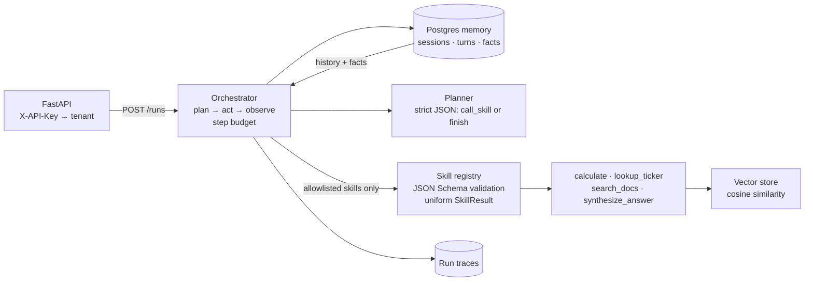

# Internal Agent Platform

**A platform for teams to stand up LLM agents as configuration: a registry of schema-validated skills, a memory-aware plan–act–observe orchestrator, Postgres-backed session memory, citation-grounded retrieval, an eval harness, and tenant-scoped API keys.**

Most internal agent projects start as one team's script and stay that way. This project treats agents as a shared platform instead: a team publishes a *skill* once (a name, a JSON Schema, a handler), and any agent can be granted it. An *agent* is just config — a role, an allowlist of skills, a step budget, and whether its answers must be grounded in citations. The platform supplies the loop, memory, retrieval, reliability, and evaluation.



## Core ideas

- **Skills are the reusable unit.** Each skill declares a description (what the planner reads), a JSON Schema for its input, and whether it has side effects. The registry precompiles a Draft 2020-12 validator per skill; bad arguments come back as a failed `SkillResult`, not an exception.
- **Failures are data.** Every call returns the same envelope (`ok`, `output`, `error`, `latency_ms`), so a flaky skill never crashes the loop.
- **Least privilege per agent.** The planner only sees skills in the agent's allowlist, and a request for anything else is recorded as a refused step.
- **Memory-aware planning.** Before planning, the orchestrator loads the session's last six turns and its durable facts; after finishing, it records the turn. Facts upsert by `(session, key)`.
- **Deterministic planner contract.** The model must return `{"action": "call_skill", ...}` or `{"action": "finish", ...}`; unparseable or unknown actions fail soft to an honest "unable to plan" answer. A built-in mock provider lets the platform run end to end without an API key.
- **Grounding as a checkable property.** Retrieval skills return citations, and agents with `require_grounding` can be scored on whether a run produced at least one.
- **Tenant isolation from the credential.** Middleware maps `X-API-Key` to a tenant (configured via `PLATFORM_API_KEYS="key:tenant,..."`); agents, sessions, and runs are scoped to it.
- **Reliability and guardrail building blocks.** An executor with bounded retries, exponential backoff, a slow-call timeout, and a per-skill circuit breaker (opens after 5 consecutive failures, 30s cooldown); a guardrail that blocks side-effecting skills unless explicitly approved for the agent.
- **Ship on evidence.** The eval harness runs task cases against an agent and reports completion and grounding rates.

## Skill registry behavior

Verified by calling the bundled skills directly:

```python
registry.call("calculate", {"a": 6, "b": 7, "op": "mul"})
# SkillResult(ok=True, output=42, ...)

registry.call("calculate", {"a": 1, "b": 0, "op": "div"}).error
# 'division by zero'

registry.call("calculate", {"a": 1, "op": "pow"}).error
# "input validation failed: 'pow' is not one of ['add', 'mul', 'div']"
```

## API

| Method | Path | Description |
|---|---|---|
| `POST` | `/agents` | Register an agent: `{id, goal_role, allowed_skills, max_steps (1–20), require_grounding}` |
| `POST` | `/runs` | Run an agent against a goal, optionally continuing a `session_id` |
| `GET` | `/runs/{trace_id}` | Read a run's trace |
| `GET` | `/health` | Liveness (no key required) |

## Layout

| Path | Purpose |
|---|---|
| `platform/skills/` | `Skill`/`SkillResult`, the registry, and built-in skills |
| `platform/agent/` | `Agent` config, orchestrator, grounding check |
| `platform/llm/` | Provider seam (mock by default) and the planner |
| `platform/memory/` | Session, turn, and fact persistence |
| `platform/retrieval/` | Ingestion, vector store, `search_docs` and `synthesize_answer` skills |
| `platform/execution/` | Retrying, circuit-breaking executor and side-effect guardrail |
| `platform/eval/` | Eval harness and suite |
| `platform/observability/` | Run trace recording |
| `platform/api/` | App, routes, tenant auth middleware |
| `platform/ui/ControlPanel.jsx` | Control panel component for triggering runs |

## Status

The skill system works in isolation; the service doesn't start yet:

- **The package name shadows the standard library.** Code lives in a directory named `platform`, which collides with Python's built-in `platform` module, so imports like `platform.api.main` fail. Renaming the package is the first fix.
- **Missing modules:** `platform/db/postgres.py` (`cursor`, `init_schema`), `platform/retrieval/embeddings.py`, and `platform/llm/providers.py`. The `run_traces` table used by tracing isn't in `schema.sql`.
- **Building blocks not yet wired in:** the orchestrator calls the registry directly rather than the resilient executor, and doesn't apply the side-effect guardrail or enforce `require_grounding`.
- Registered agents live in memory; there's no dependency file or test suite.
